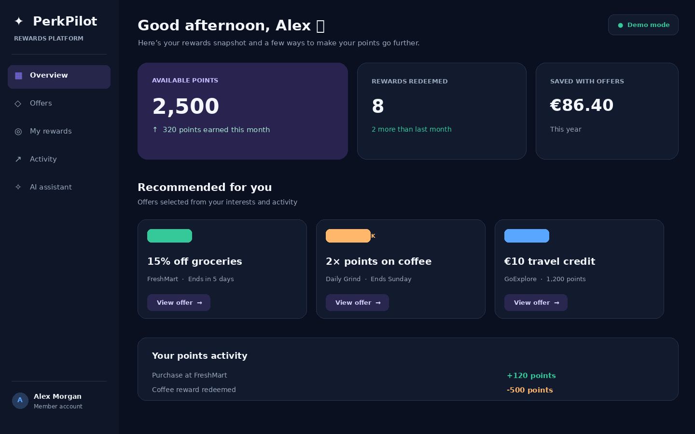
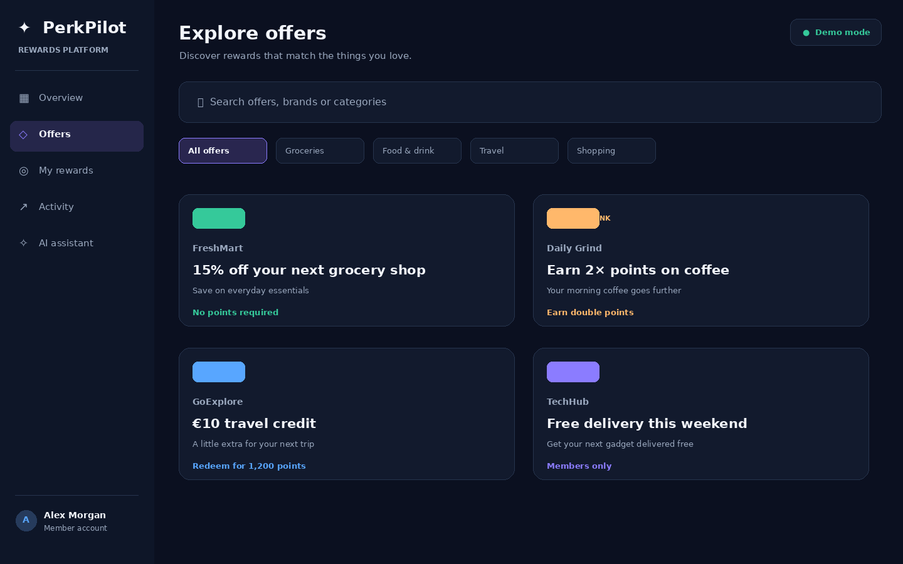
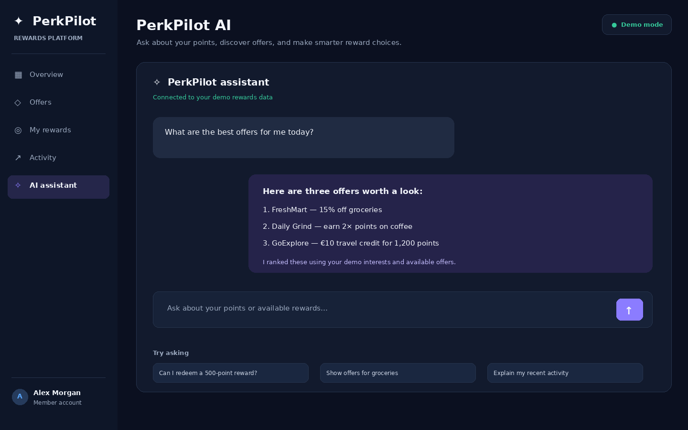

# PerkPilot

**An AI-powered rewards and offers platform** — a portfolio project focused on practical AI engineering, backend development, and production-minded software practices.

PerkPilot will let users discover offers, earn and redeem points, and get personalized recommendations from an AI assistant grounded in real application data.

> Status: **Phase 1 — project foundation**. This repository currently contains a small FastAPI service and automated tests. Features will be added incrementally.

## Current features

- FastAPI application with automatic interactive API documentation.
- `GET /` welcome endpoint.
- `GET /health` health-check endpoint.
- Pytest tests for both endpoints.

## UI previews

The images below are **concept mockups**, not screenshots of a running frontend. They illustrate the intended product experience while the current repository is still in its API-foundation phase.

### Customer dashboard


### Offers discovery


### AI assistant


## Tech roadmap

- **Backend:** Python, FastAPI, Pydantic
- **Data:** PostgreSQL and SQL
- **AI:** LLM integration, tool calling, recommendation logic, and evaluation
- **Quality:** Pytest, integration tests, linting
- **Delivery:** Docker and GitHub Actions
- **Frontend (later):** React and TypeScript

## Requirements

- Python 3.11+
- Git

## Run locally

### 1. Clone the repository

```bash
git clone https://github.com/YOUR-USERNAME/perkpilot.git
cd perkpilot
```

### 2. Create and activate a virtual environment

**macOS / Linux**
```bash
python3 -m venv .venv
source .venv/bin/activate
```

**Windows PowerShell**
```powershell
py -m venv .venv
.venv\Scripts\Activate.ps1
```

### 3. Install dependencies

```bash
python -m pip install --upgrade pip
pip install -r requirements.txt
```

### 4. Start the API

```bash
uvicorn app.main:app --reload
```

Open:
- API welcome: http://127.0.0.1:8000/
- Health check: http://127.0.0.1:8000/health
- Interactive API docs: http://127.0.0.1:8000/docs

Stop the server with `Ctrl+C`.

## Run tests

In a second terminal (with the virtual environment activated):

```bash
pytest
```

## Project structure

```text
perkpilot/
├── app/
│   ├── __init__.py
│   └── main.py
├── tests/
│   └── test_main.py
├── .env.example
├── .gitignore
├── README.md
└── requirements.txt
```

## Engineering principles

- Keep business rules in the backend, not in the AI prompt.
- Validate all inputs and enforce authorization server-side.
- Treat points redemption as a transaction; prevent duplicate spending.
- Keep secrets in environment variables and never commit `.env`.
- Test important behavior, especially money- and points-related operations.
- Evaluate AI outputs and tool calls rather than assuming they are correct.

## Planned milestones

1. **Foundation:** FastAPI app, health endpoint, tests. *(Current)*
2. **Core domain:** users, offers, points ledger, and safe redemption.
3. **AI recommendations:** explainable recommendations based on application data.
4. **AI assistant:** tool calling with strict backend validation and permissions.
5. **Production readiness:** PostgreSQL, Docker, CI, logging, and deployment.
6. **User interface:** React dashboard and assistant experience.

## License

This project is currently a personal portfolio project. Add a license before accepting external contributions or permitting reuse.
